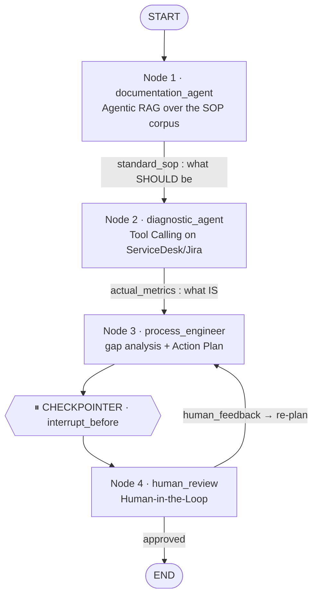

# سیستم چندعاملی تحلیل و اتوماسیون فرآیندهای سازمانی
# Multi-Agent System for the Analysis & Automation of Organisational Processes

**Generative AI — Final Project**

A **LangGraph** decision graph in which four agents read the company's
documentation (**Agentic RAG**), measure the real process through tools
(**Tool Calling**), engineer an automation Action Plan, and wait for the
systems manager's approval (**Human-in-the-Loop**).

The deliverable notebook is **[`Farzaneh_Ghasri.ipynb`](Farzaneh_Ghasri.ipynb)**
— it is stored with all outputs already executed, so it can be read without
running anything.

---

## Quick start

```bash
pip install -r requirements.txt          # langgraph + langchain-core only
PYTHONPATH=src python -m pytest tests/ -q # 63 tests, ~0.5 s
jupyter lab Farzaneh_Ghasri.ipynb
```

Everything runs **fully offline and deterministically** — no API key, no
network access, no model download. A hosted chat model is optional (see
[below](#optional-running-with-a-hosted-language-model)).

```python
from process_automation import build_system
from process_automation.infrastructure.approval import ConsoleApprovalGateway

system = build_system(approval_gateway=ConsoleApprovalGateway())
result = system.session.run("VPN access provisioning for new personnel")

print(result.plan.to_markdown())
```

---

## The workflow



| # | Node | Role | Mechanism | Output |
|---|------|------|-----------|--------|
| ۱ | `documentation_agent` | تحلیل‌گر مستندات | vector search + structured SOP extraction | the approved SLA and steps |
| ۲ | `diagnostic_agent` | بازرس عملیات | two `@tool` functions against a mock ServiceDesk API | real metrics and stage timings |
| ۳ | `process_engineer` | مهندس فرآیند | gap rules + remediation strategy registry | Action Plan with automation scripts |
| ۴ | `human_review` | تاییدیه مدیر سیستم‌ها | `MemorySaver` checkpointer + `interrupt_before` | approval, or feedback → new revision |

### The two scenarios required by the brief

**۱ — Bottleneck found, automation accepted.** VPN access provisioning: the SOP
says **2 h**, the ticket data says **42 h**, and 82 % of the cycle is the
"Direct manager approval" stage waiting in an inbox. The engineer proposes a
messenger approval bot that keeps the manager's *decision* and deletes the
*waiting*, plus a direct firewall API call. Projected: **42 h → 4.0 h**.

**۲ — Human intervention and course correction.** Privileged database access:
the engineer's first revision proposes **removing the security officer review**
(the largest single delay). The graph stops before anything is executed. The
reviewer answers *"the security approval cannot be removed — accelerate it
instead"*; that sentence becomes a machine-checkable constraint, the offending
strategy removes itself from the candidate list, and revision 2 proposes a
risk-scored fast-track dashboard that keeps the control. Projected:
**26 h → 8.3 h**.

---

## Layout

```
src/process_automation/
├── domain/                  business rules — imports no framework at all
│   ├── models.py            entities & value objects (SOP, metrics, gaps, plan)
│   ├── gap_analysis.py      GapRule strategies + GapAnalyzer
│   ├── remediation.py       the catalogue of automation remedies
│   └── feedback.py          free-text feedback → machine-checkable constraints
├── interfaces.py            the ports (8 small protocols)
├── state.py                 WorkflowState (as specified) + ProcessAnalysisState
├── config.py                Settings dataclasses
├── agents/                  the 4 graph nodes, one file each
├── graph/                   routing.py (conditional edges) + builder.py
├── infrastructure/          adapters: embeddings, retrieval, tools, LLM,
│                            approval gateways, Mermaid rendering
├── application/             container.py (composition root) + session.py (runner)
└── resources/
    ├── knowledge_base/      3 SOP documents — the RAG corpus
    └── service_desk/        the mock Jira/ServiceDesk export
tests/                       63 tests across all layers
```

Dependency arrows point **inwards**: `domain/` imports nothing from the
project, and `infrastructure/` is imported by the composition root alone.

---

## SOLID in this codebase

| Principle | Where | What it bought |
|---|---|---|
| **Single Responsibility** | `GapAnalyzer` *detects*, `RemediationRegistry` *prescribes*, `routing.py` *routes*, `WorkflowSession` *drives*, `ApprovalGateway` *asks*. | The revision loop was re-tuned without reopening an agent; the router is testable with a dict literal. |
| **Open/Closed** | `GapRule` and `RemediationStrategy` are registered, never `if/elif`-ed; `ProcessAnalysisState` *extends* the mandated `WorkflowState`; SOP documents are data files. | A new deviation, remedy or whole process is added without editing an existing class. |
| **Liskov Substitution** | `HashingTfidfEmbeddings` ↔ `LangChainEmbeddingsAdapter`; the four `ApprovalGateway`s; `RuleBasedSolutionComposer` ↔ `LlmNarrativeComposer`. | One compiled graph serves a scripted run, an interactive run and the test suite. |
| **Interface Segregation** | Eight tiny ports in `interfaces.py`; a `MetricsProvider` implementer knows nothing about embeddings. | Test doubles are three lines long. |
| **Dependency Inversion** | Agents depend on ports only; concrete classes are chosen in `application/container.py` alone. | Moving to FAISS + a real Jira API + a hosted LLM is a one-file change. |

### Design decisions worth defending

* **The numbers are deterministic; the prose is optional.** SLA breaches,
  bottleneck shares and expected savings come from auditable rules. A language
  model is attached as a *decorator* that rewrites the management summary only,
  so an outage — or a hallucination — can never alter a figure in a compliance
  document.
* **The engineer is aggressive on purpose.** `allow_control_removal=True`
  reproduces scenario 2. Flipping that one setting yields a policy-compliant
  engineer that never proposes dropping a documented control (there is a test).
* **Constraints are sticky.** A limit stated in revision 1 still holds in
  revision 3, which is what makes the feedback loop converge.
* **Honest projections.** Rework savings are marked `amortised` and excluded
  from the single-request cycle-time projection, so a plan never promises
  42 h → −1 h.

---

## Adding a process

Drop a Markdown file in `src/process_automation/resources/knowledge_base/` with
a front-matter block and an "Approved steps" table, and add the matching record
to `resources/service_desk/metrics.json`. No Python changes.

```markdown
---
document_id: SOP-HR-003
process: Onboarding equipment handover
aliases: laptop handover, new joiner equipment
sla_hours: 6
owner: Workplace IT
---

## 3. Approved steps

| # | Step | Owner | Target (h) | Type | Mandatory control |
|---|------|-------|-----------|------|-------------------|
| 1 | Request registration | Bot | 0.5 | automated | no |
| 2 | Asset allocation | Workplace IT | 5.5 | manual_provisioning | no |
```

The `Type` column drives the remediation: `automated`, `manual_approval`,
`manual_provisioning`, `security_review`, `data_entry`, `waiting_queue`.

## Optional: running with a hosted language model

```bash
pip install langchain-openai          # or langchain-anthropic
export OPENAI_API_KEY=...
export PA_REASONING_MODE=llm          # 'auto' (default) | 'llm' | 'offline'
```

`build_language_model()` then returns a chat model and the container decorates
the composer with `LlmNarrativeComposer`. Nothing else changes — which is the
point.

## Graph rendering

`system.visualizer.render(system.compiled_graph)` calls
`.get_graph().draw_mermaid_png()` as the brief requires. That call renders
through the remote `mermaid.ink` service; on an offline or firewalled machine
it degrades to writing `artifacts/workflow_graph.mmd`, which the notebook then
renders natively. The deliverable is inspectable either way.
