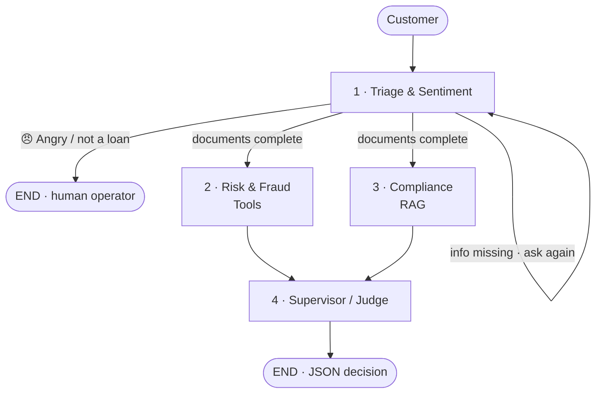

# 🏦 Intelligent Multi-Agent Credit Committee & Fraud Detection
### کمیته‌ی هوشمند و چندعاملی تخصیص اعتبار و کشف تقلب

**Generative AI Bootcamp — Final Project**

In a real bank a loan is never approved by one person. It goes to a **credit
committee**: someone checks the identity, someone checks bounced cheques and
debts, a legal expert checks the Central Bank circulars, and a manager decides.

This project simulates that committee with **four AI agents** that pass one
shared case file around inside a **LangGraph** decision graph — and everything
runs **locally**, so no customer data ever leaves the machine.

---

## The committee

| # | Agent (node) | Role | Technique | Output |
|---|---|---|---|---|
| 1 | **Triage & Sentiment** | front desk | **structured output** + **interrupt** | tone, national ID, loan request |
| 2 | **Risk & Fraud** | risk analyst | **Tool Calling** | credit score + red flags 🚩 |
| 3 | **Compliance** | legal expert | **RAG** | allowed / not allowed + collateral |
| 4 | **Supervisor / Judge** | committee head | **structured output** | final decision as **JSON** |



---

## Techniques used — quick index

| Technique | Where |
|---|---|
| **LangGraph** state machine (nodes + edges) | Step 3.5 |
| **Shared State** (`TypedDict`) with a **reducer** (`operator.add`) | Step 1 |
| **Local LLM with Ollama** (`qwen2.5:7b`, `temperature=0`) | Step 0 |
| **Structured Output** (Pydantic + `with_structured_output`) | Steps 3.1, 3.4 |
| **Sentiment analysis** as a classification task | Step 3.1 |
| **Tool Calling** (`@tool` + `bind_tools`) | Steps 2, 3.2 |
| **RAG** (PDF loader → chunks → embeddings → **Chroma** vectorstore) | Step 3.3 |
| **Conditional edges** (routing function) | Steps 3.1, 3.5 |
| **Human-in-the-loop** (`interrupt` + `Command(resume=…)` + checkpointer) | Step 3.1 |
| **Parallel execution** (fan-out / fan-in) | Step 3.5 |
| **Rule-based scoring** next to the LLM (hybrid) | Step 3.2 |
| **Input normalisation** (Persian/Arabic digits → English) | Step 2 |
| **Guardrails** (safety nets around the LLM's output) | Steps 3.2, 3.3, 3.4 |
| **Streaming** (`graph.stream`) for step-by-step observability | Step 4.2 |

---

## How it works, step by step

### Step 0 — A **local LLM with Ollama**
`ChatOllama` talks to a model running on my own computer (`qwen2.5:7b`), with
`temperature=0` so the same case always gets the same decision. Nothing is sent
to a cloud API — essential for banking data.

### Step 1 — The **shared State**
`BankingState` is a `TypedDict`: the case file every agent reads and writes
(`customer_id`, `loan_request`, `sentiment`, `risk_report`, `compliance_check`,
`final_decision`). The conversation log uses a **reducer**:

```python
messages: Annotated[list, operator.add]   # new messages are APPENDED, never overwritten
```

That one line is what makes the parallel step in Step 3.5 safe.

### Step 2 — The **tools** (mock banking APIs)
Four functions get the `@tool` decorator, which turns them into tools the LLM
can read and request: `get_credit_score`, `check_bounced_checks`,
`check_current_debts`, `check_blacklist`. Their **docstring is the description
the LLM sees**, so it knows when to use each one.

A small preprocessing helper converts Persian/Arabic digits (`۱۲۳۴۵۶۷۸۹۰`) into
English ones, so an ID typed in any format still matches the database.

### Step 3.1 — Triage: **structured output** + **interrupt**
Instead of parsing free text, the LLM is forced to answer inside a Pydantic
model via `with_structured_output(...)`:

```python
class SentimentAnalysis(BaseModel):
    sentiment: Literal["Normal", "Angry"]
    reason: str
```

The agent does **one job per pass**: welcome → read the message → ask for
whatever is missing. When something is missing it calls `interrupt(question)`,
which **pauses the whole graph**; the answer comes back with
`Command(resume=answer)`. This needs a **checkpointer** (`InMemorySaver`) plus a
`thread_id` per conversation — that is the graph's memory.

### Step 3.2 — Risk & Fraud: **Tool Calling**
```
LLM chooses the tools → our code runs them → safety net → bank rules → LLM summary
```
`llm.bind_tools(banking_tools)` lets the LLM decide which tools to call and with
which arguments (`response.tool_calls`); **our code** actually executes them —
the LLM never runs code. If it forgets one, a **safety net** calls it anyway, so
the report is never incomplete.

The risk level itself is **rule-based, not LLM-based** — deliberately, so it is
explainable and repeatable:

A red flag 🚩 is raised for: the **blacklist**, **≥ 1 bounced cheque**, **≥ 1
overdue installment**, a **credit score below 600**, or a **total debt over
500 M Toman**. The flags then give the level: blacklisted → `Critical`, no
flags → `Low`, 1–2 flags → `Medium`, 3 or more → `High`.

The LLM only writes the short human summary at the end.

### Step 3.3 — Compliance: **RAG**
The model knows nothing about my bank's circulars, and they change monthly. So
instead of retraining it, the right pages are handed to it at question time:

```
1 RETRIEVE  search the vectorstore  →  2 AUGMENT  put the circulars in the prompt  →  3 GENERATE  answer from them only
```

| Stage | Tool |
|---|---|
| load 4 Persian PDF circulars | `PyPDFDirectoryLoader` |
| cut into chunks (800 chars, 100 overlap) | `RecursiveCharacterTextSplitter` |
| turn chunks into vectors | `OllamaEmbeddings` — **`bge-m3`** |
| store & search by meaning | **Chroma** (`k=2` nearest chunks) |

### Step 3.4 — Supervisor / Judge: **structured output** again
The judge reads both reports and returns the final JSON. Here structured output
works perfectly, because every field is short:

```json
{"status": "Approved", "max_amount": 500000000, "collateral": "Promissory Note & Business License"}
```

Rules: `High`/`Critical` risk → **Rejected**; `غیرمجاز` → **Rejected**;
otherwise **Approved**. A **guardrail** in code then forces `max_amount = 0` and
`collateral = "None"` on every rejection, because the LLM sometimes filled them
in anyway.

### Step 3.5 — The graph: **conditional edges** + **parallel execution**
```python
builder.add_conditional_edges("triage_agent", route_from_triage, [...])
builder.add_edge(["risk_fraud_agent", "compliance_agent"], "supervisor_agent")
```
* The routing function returns **where to go next** based only on the State:
  angry → `END`, missing info → back to Triage, complete → the committee.
* Returning a **list** of node names starts Risk and Compliance **in parallel**
  (fan-out); the edge *from* a list makes the Supervisor **wait for both**
  (fan-in). They are independent, so this halves the waiting time.

### Step 4 — Scenarios, with **streaming**
`graph.stream(..., stream_mode=["updates", "values"])` shows which agent just
ran and the full State after it, so the whole case can be followed step by step.

| Scenario | Input | Result |
|---|---|---|
| 🟢 **1 — approved** | 500 M equipment loan, good customer | Normal → score 800, no red flags → circular 1405/101 → `{"status": "Approved", "max_amount": 500000000, "collateral": "Promissory Note & Business License"}` |
| 🔴 **2 — angry customer** | complaint about long waiting | Triage detects `Angry` → graph **stops immediately**, no risk report, no decision, apology + referral to the branch manager |

---

## Two lessons learned

* **The embedding model matters more than the LLM for RAG.** With
  `nomic-embed-text` (mostly English), *«وام خرید تجهیزات»* retrieved the **car
  loan** circular ❌. Switching to the multilingual **`bge-m3`** fixed it ✅.
* **Structured output is not always the right answer.** For long Persian text
  the 7B model dropped items and invented circular numbers. A fixed **5-line
  text format** was simpler, correct, and about **2× faster**.

---

## How to run

```bash
# 1. Ollama + the two models
ollama pull qwen2.5:7b
ollama pull bge-m3
ollama serve

# 2. Python packages (or run the first notebook cell)
pip install -q langgraph langchain langchain-core langchain-ollama \
               langchain-community langchain-text-splitters \
               langchain-chroma chromadb pypdf

# 3. Open the notebook and run the cells in order
jupyter lab Credit_Committee_MultiAgent.ipynb
```

```
Credit_Committee_MultiAgent.ipynb   the whole project, step by step
circulars/                          4 fictional Central Bank circulars (PDF) for the RAG agent
```

> The circulars, the customers and the banking APIs are **all fictional**, made
> only for this project.
